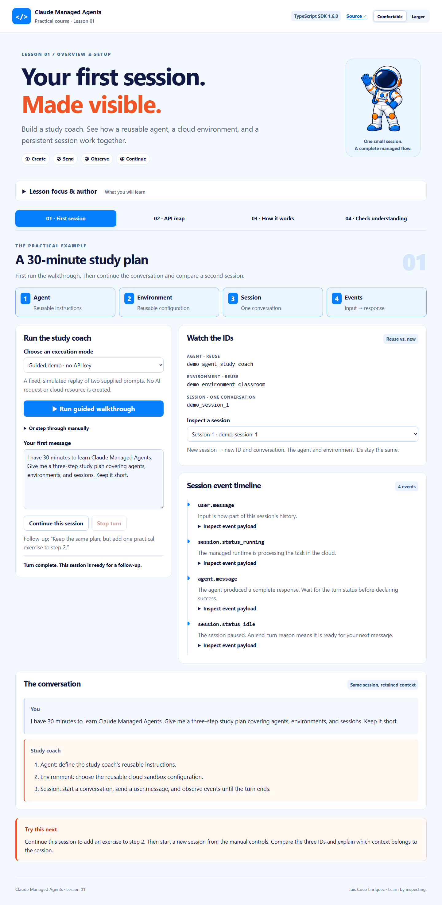

# Lesson 01 — Claude Managed Agents: First Session Lab

A practical companion to **Lesson 1: Overview and Setup**. Build a study coach and watch the complete Managed Agents lifecycle: reusable agent → reusable environment → new session → user message → events → follow-up.

**[Application source](https://github.com/luiscoco/claude-managed-agents-lesson-01)** · Author: Luis Coco Enríquez



## What students do

1. Run a guided walkthrough and inspect the three resource IDs.
2. Expand event payloads and find `session.status_idle` with `stop_reason.type: "end_turn"`.
3. Continue the same session to add a practical exercise to the study plan.
4. Create another session, reusing the agent and environment. Compare IDs and conversation histories.
5. Explore the API map, read the runnable TypeScript example, and answer five questions.

The four activities follow the course references: **First session**, **API map**, **How it works**, and **Check understanding**. The interface keeps the pale blue background, navy text, orange emphasis, blue controls, rounded panels, astronaut mascot, and saved Comfortable/Larger reading controls.

AI replies display formatted headings, lists, emphasis, tables, and inline code instead of raw Markdown markers. Code snippets use a shared syntax-color theme throughout the application: response code fences, API-map examples, setup commands, the runnable TypeScript walkthrough, and event JSON payloads. Common fenced-code languages are recognized; unlabelled blocks use automatic detection, and unsupported languages remain readable as plain code. Model HTML is discarded and parsed response content is sanitized before display.

All nine API-map cards include an expandable, syntax-highlighted TypeScript example, including the later-lesson previews for threads, session resources, vaults, memory stores, and deployments. These snippets are displayed for study; expanding a card does not execute it. They assume a server-side SDK client and existing resource IDs where indicated.

**How it works** also includes an interactive UML teaching guide: a component architecture diagram, an expandable activity workflow with responsibility swimlanes, and ten selectable steps with highlighted code. It explains request validation, resource reuse, session creation, stream-before-send ordering, event rendering, stop reasons, same-session follow-ups, new sessions, and interruption. The native SVG diagrams have accessible descriptions and can be scrolled on smaller screens.

Preview the [UML architecture](docs/uml-architecture.png) and [complete activity workflow](docs/uml-workflow.png), or explore them interactively in the app’s **How it works** activity.

## Run locally

Requires **Node.js 24 LTS** and npm. Node 22.14+ is also supported by the dependency set.

```sh
git clone https://github.com/luiscoco/claude-managed-agents-lesson-01.git
cd claude-managed-agents-lesson-01
npm ci
npm run dev
```

Open **http://127.0.0.1:4321**. No API key is required for the guided demo.

### Guided demo

The demo is an explicitly labelled, deterministic replay of two supplied prompts. It **does not call an AI model, create cloud resources, or answer arbitrary questions**. IDs start with `demo_`; outputs are scripted. It teaches resource reuse, session context, and event order without an account. The prompt is read-only in this mode.

### Live Claude Managed Agents

Copy `.env.example` to `.env`:

```powershell
# Windows PowerShell
Copy-Item .env.example .env
```

```sh
# macOS / Linux
cp .env.example .env
```

Edit `.env`, set **your own Anthropic API key with Managed Agents access**, and restart the server:

```dotenv
ANTHROPIC_API_KEY=your_key_here
ANTHROPIC_MODEL=claude-opus-5-5
```

Select **Live** in the application. The model is configurable because access and availability depend on the account. Live actions create real cloud resources and incur Anthropic usage charges. No tools are enabled: the coach only produces a short teaching response.

The app uses the official **`@anthropic-ai/sdk` 1.6.0**. Every AI operation goes through **Claude Managed Agents**: `client.beta.agents`, `environments`, `sessions`, and `sessions.events`. There is no Claude Agent SDK, local Claude runtime, Messages API agent loop, or alternate AI service.

The API key stays in the Node process. It is never sent to the browser, written to localStorage, or included in this repository. The `.env` and `.data` directories are ignored by Git.

### Reuse resources

The live app saves created agent and environment IDs in `.data/resources.json`. A second walkthrough reuses those IDs and creates a new session. Partial setup is saved after each successful creation, so an environment failure does not cause an extra agent to be created on retry.

To use existing resources instead, set:

```dotenv
MANAGED_AGENT_ID=your_agent_id
MANAGED_ENVIRONMENT_ID=your_environment_id
```

Existing IDs must belong to your API key’s workspace and be compatible with this lesson. API errors are reported without revealing credentials. The app does not modify existing agents or environments to enforce the coach instructions; use the resources created by this lab for the expected exercise.

The selector and visible transcripts are retained in Node memory until the server restarts. The managed session itself persists in Anthropic’s cloud. This local teaching app does not implement cross-restart session discovery, background recovery, or cloud resource deletion. Review/retire cloud resources through the Anthropic Console when finished. Never assume that closing a browser deletes a session.

## Teaching flow

| Concept              | Student action         | What to observe                                                    |
| -------------------- | ---------------------- | ------------------------------------------------------------------ |
| Reusable agent       | Create/reuse resources | Stable agent ID and instructions                                   |
| Reusable environment | Create/reuse resources | Stable configuration ID; sessions have separate execution contexts |
| Session              | Start a new session    | New session ID, empty local transcript                             |
| User input           | Send a message         | `user.message` and running status                                  |
| Agent response       | Inspect event timeline | Text in `agent.message`                                            |
| Turn completion      | Inspect the idle event | `stop_reason.type === "end_turn"`                                  |
| Conversation context | Continue this session  | Same ID, updated step 2                                            |

`agent.message` alone is not a completion signal. An idle event can also report refusal, budget exhaustion, retries exhausted, or required action. The app treats those outcomes as needing attention rather than reporting success. A prematurely closed stream also fails explicitly.

The official stream delivers **events emitted after the connection opens**. The live adapter opens the stream **before** sending the message, preventing a fast-response race. A Stop turn action requests `user.interrupt` and aborts local observation. Disconnects and the 120-second observation timeout also request interruption. These are best-effort requests; inspect the cloud session if a network failure leaves its state uncertain.

## Structure

```text
src/
  client/                 # Browser UI, tabs, timeline, quiz, reading controls
  server/
    index.ts              # Loopback HTTP host, API validation, SSE bridge
    lab.ts                # Session coordinator, demo and Managed Agents adapters
  shared/lesson.ts         # Teaching copy, types, API map and quiz
  examples/first-session.ts # Standalone live TypeScript walkthrough
test/
  lab.test.ts             # Reuse, context, failure outcomes, cancellation, persistence
  sdk.test.ts             # Official SDK with mocked HTTP/SSE transport
  browser/lesson.spec.ts   # Desktop/mobile learner journey and API boundary checks
docs/
  instructor-guide.md
  visual-style.md
```

The browser calls the local Node server. Node keeps the key and uses Anthropic’s SDK to create resources, send events, and stream observations. Native HTTP, TypeScript, and Vite provide the application shell; Claude Managed Agents provides all live AI execution.

## Commands

| Command            | Purpose                                                           |
| ------------------ | ----------------------------------------------------------------- |
| `npm run dev`      | Local server with Vite UI development middleware                  |
| `npm run check`    | Type checks, backend/SDK tests, production build                  |
| `npm run build`    | Build the client and server                                       |
| `npm start`        | Serve the production build on loopback port 4321                  |
| `npm run test:e2e` | Desktop/mobile browser tests against the production build         |
| `npm run example`  | Standalone **live** example; requires a key and creates a session |

For browser tests, first run `npm run build` and `npx playwright install chromium`. CI runs these checks on Node 24. The standalone example prints its resource IDs; pass them through the environment variables above to reuse its agent/environment on later runs. Unlike the web app, it does not save IDs to `.data`.

Set `PORT` to change the local port. This is a local educational application bound to `127.0.0.1`, without multi-user authentication. It should not be exposed directly as a public API.

## References and API contract

Implementation checked against the installed SDK’s TypeScript declarations and the official Managed Agents documentation:

- [Managed Agents quickstart](https://platform.claude.com/docs/en/managed-agents/quickstart)
- [Agent setup](https://platform.claude.com/docs/en/managed-agents/agent-setup)
- [Environments](https://platform.claude.com/docs/en/managed-agents/environments)
- [Sessions](https://platform.claude.com/docs/en/managed-agents/sessions)
- [Events and streaming](https://platform.claude.com/docs/en/managed-agents/events-and-streaming)
- [Official TypeScript SDK](https://github.com/anthropics/anthropic-sdk-typescript)

The beta contract is `managed-agents-2026-04-01`; the SDK’s managed endpoint methods attach it automatically. Beta APIs can evolve. When upgrading, update the lockfile, inspect SDK types, and rerun the transport and browser checks.

Course design references: [Lesson 01](https://github.com/luiscoco/claude-agent-sdk-lesson-01), [Lesson 02](https://github.com/luiscoco/claude-agent-sdk-lesson-02), [Lesson 03](https://github.com/luiscoco/claude-agent-sdk-lesson-03). The course astronaut asset is reused from Lesson 01 under its MIT license. See [NOTICE](NOTICE) and [LICENSE](LICENSE).

## Validation scope

Automated checks exercise the complete demo journey and the official SDK with mocked HTTP and event-stream responses. They verify request shapes, beta headers, and stream-before-send ordering without consuming an API key. A billable live session still needs to be verified with your own Managed Agents-enabled credential.
