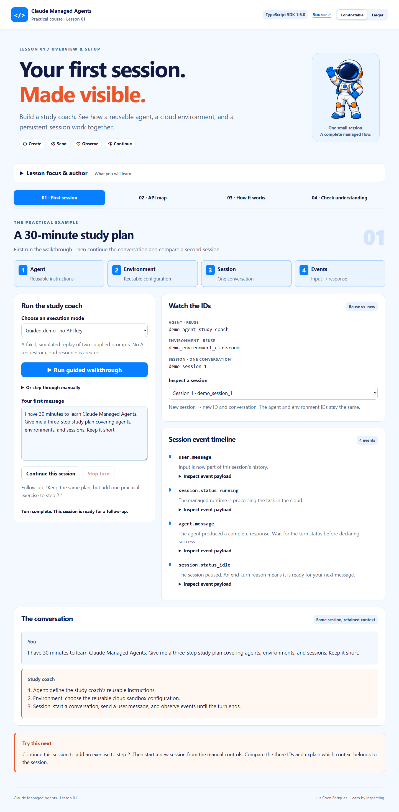
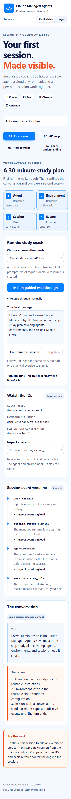

# Course visual style

This practical application follows the supplied Lesson 01–03 reference applications:

- Pale blue page `#f4f9ff`, navy text `#101a44`.
- Orange heading emphasis `#ee5425`, blue navigation/actions `#087fff`.
- Rounded white cards, light blue borders, numbered flow cards, navy code panels.
- The original course astronaut mascot, preserved with attribution.
- Large headline, optional lesson-focus panel, four teaching activities, inspectable events, code, and quiz.
- Comfortable/Larger text controls saved locally, keyboard-operable tabs, semantic forms, visible focus, and stacked mobile layout.

The runtime flow is rewritten for Claude Managed Agents. Original Agent SDK branding and runtime behavior are not carried into the practical example.
